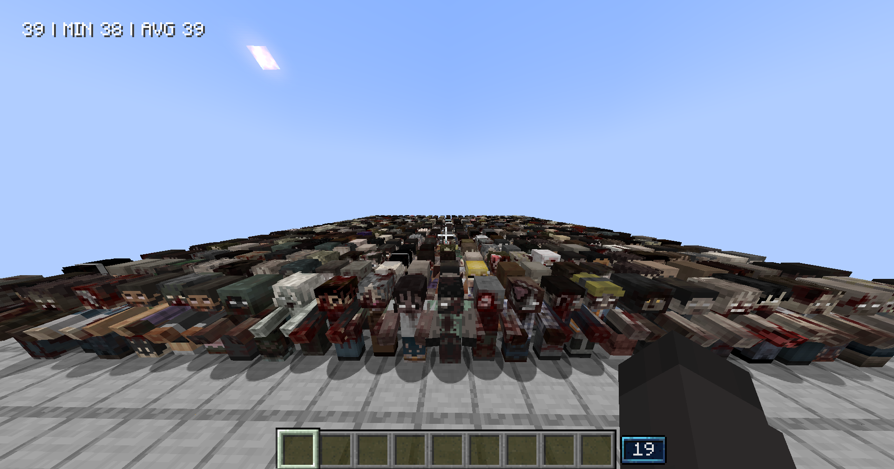
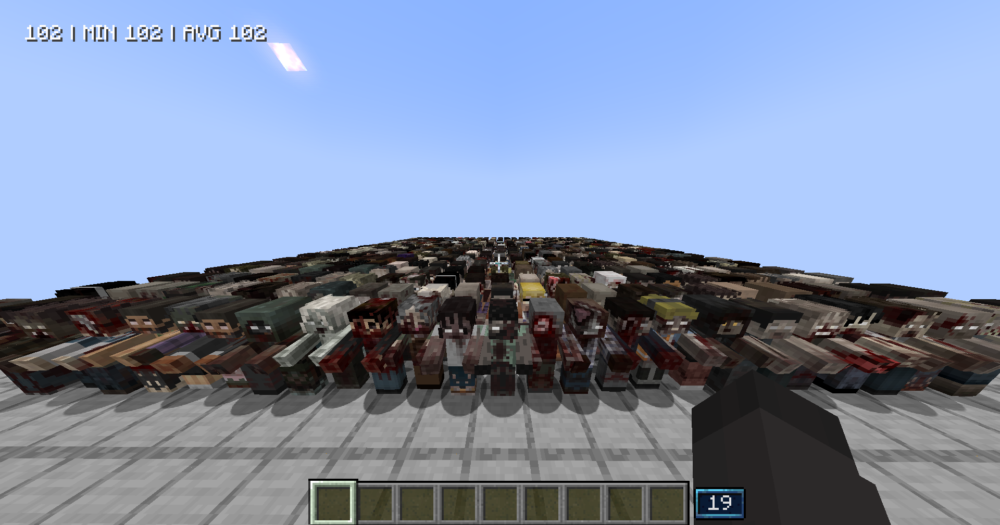
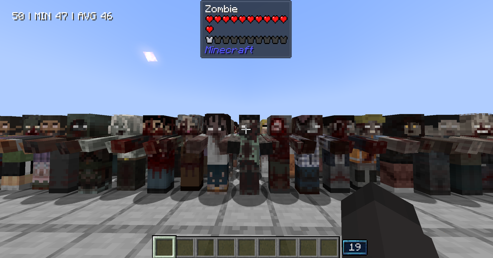
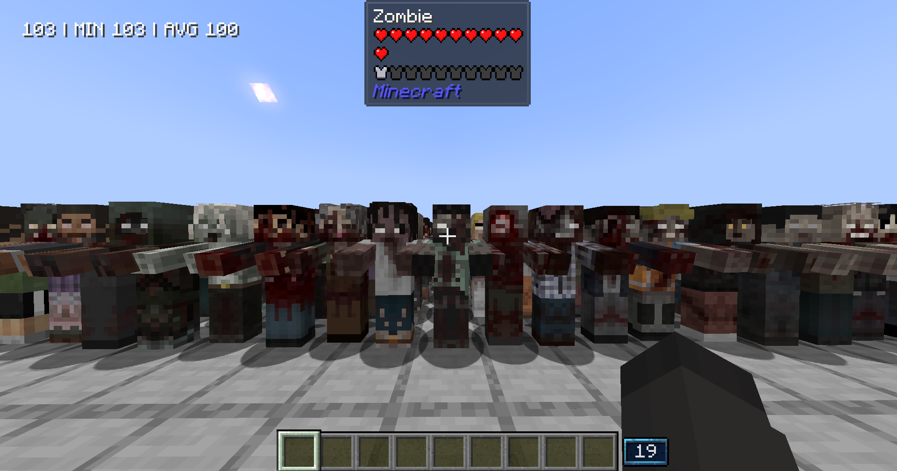

# Superb Warfare Performance Fix (Unofficial Patch)

A companion patch for [Superb Warfare](https://www.curseforge.com/minecraft/mc-mods/superb-warfare) 0.8.9.2 on Minecraft 1.20.1 (Forge). It removes most of the time Superb Warfare spends working out what you are looking at, which grows with the number of mobs around you. Superb Warfare itself is still required.

## Before And After

Looking over the horde: **39 FPS** before, **102 FPS** after.

Looking at a zombie: **50 FPS** before, **103 FPS** after.

## Faster

- Every tick, whether or not you hold anything from Superb Warfare, it checks each mob along your view for a smoke grenade cloud nearby. Each check went through every mob within 8 blocks, so in a crowd the cost grew with the square of its size: 22% of the render thread in a 515-mob scene. The check now looks only at smoke clouds and gives the same answers.

## Option

- `hideAmmoCountOverlay` in `config/superbwarfareperformancefix-client.toml` hides the ammo count overlay shown while you hold ammo or an ammo box. Off by default.

Apart from that option, everything looks and plays the same.

The log has one line for each patched class, saying how many changes applied. If a Superb Warfare version changes the smoke check, the patch leaves it alone and says so in the log.

## Building

Put Superb Warfare 0.8.9.2 (`superbwarfare-0.8.9.2-mc1.20.1-65d985a64-all.jar` from CurseForge) in `libs/` as `superbwarfare-0.8.9.2.jar`, then:

- `gradlew build` makes the mod in `build/libs/`.
- `gradlew verifySmoke` checks that the smoke check gives the same results before and after the patch, on generated worlds, and that Superb Warfare's smoke check is still the one the patch was written for.
- `gradlew verifyJar` makes a dev-only mod with `/sbwfixverify`, which compares the patched and original smoke check on every entity in a running world. Never shipped.

### Credit

This is an unofficial patch, not affiliated with Superb Warfare. [Superb Warfare](https://www.curseforge.com/minecraft/mc-mods/superb-warfare) is made by Atsuishio, Roki27, Light_Quanta and other contributors.
