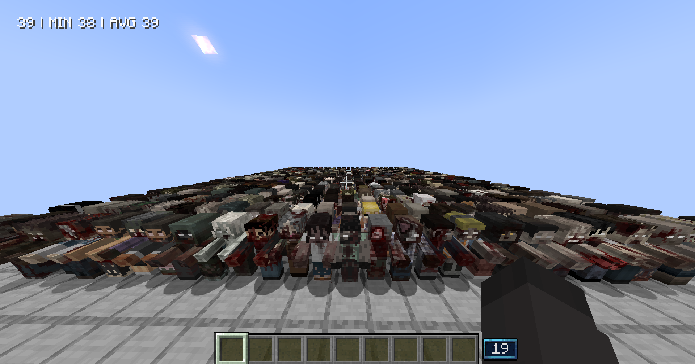
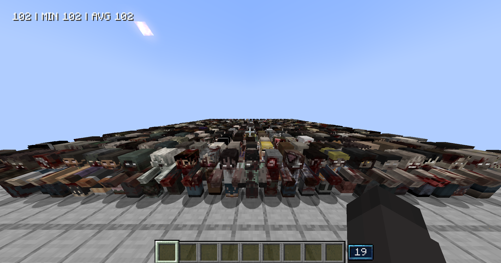
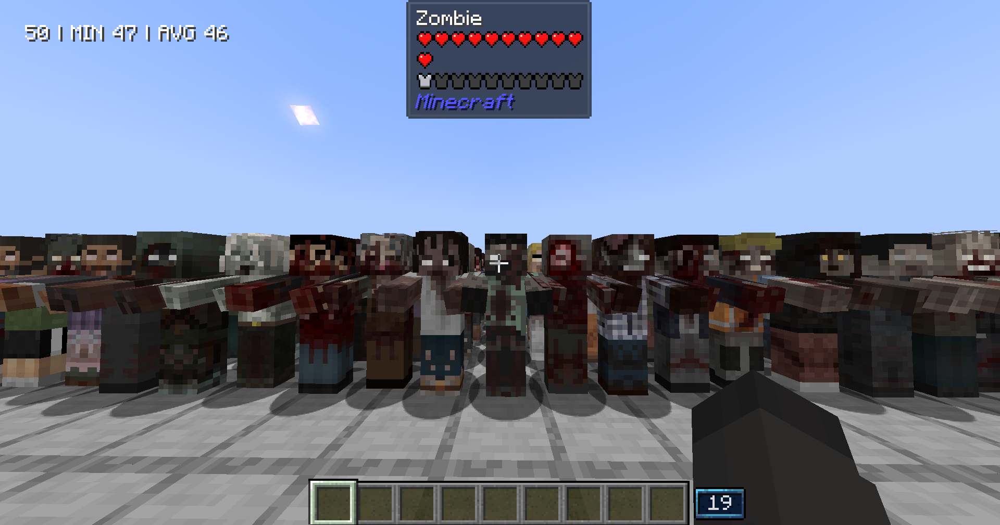
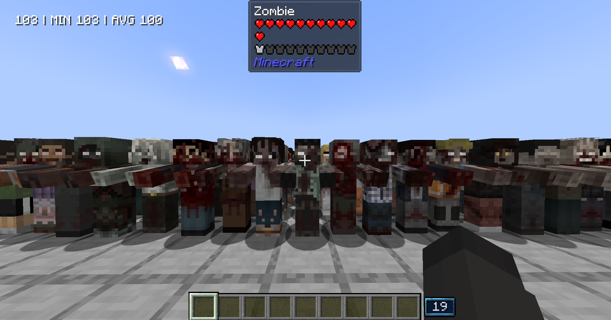

# Superb Warfare Performance Fix (Unofficial Patch)

A companion patch for [Superb Warfare](https://www.curseforge.com/minecraft/mc-mods/superb-warfare) 0.8.9.2 on Minecraft 1.20.1 (Forge). It removes <strong>most of the time Superb Warfare spends working out what you are looking at</strong>, which grows with the number of mobs around you. <strong>Superb Warfare itself is still required.</strong>

***

## Requirements

<table>
  <tr>
    <th align="left">Requirement</th>
    <th align="left">Version</th>
  </tr>
  <tr>
    <td><strong>Minecraft</strong></td>
    <td>1.20.1 (Forge)</td>
  </tr>
  <tr>
    <td><strong>Superb Warfare</strong></td>
    <td><a href="https://www.curseforge.com/minecraft/mc-mods/superb-warfare">0.8.9.2</a></td>
  </tr>
</table>

***

## Before And After

### Looking over the horde: 39 FPS to 102 FPS

<table>
  <tr>
    <td align="center"></td>
    <td align="center"></td>
  </tr>
  <tr>
    <td align="center"><strong>Before</strong>: <strong>39 FPS</strong></td>
    <td align="center"><strong>After</strong>: <strong>102 FPS</strong></td>
  </tr>
</table>

### Looking at a zombie: 50 FPS to 103 FPS

<table>
  <tr>
    <td align="center"></td>
    <td align="center"></td>
  </tr>
  <tr>
    <td align="center"><strong>Before</strong>: <strong>50 FPS</strong></td>
    <td align="center"><strong>After</strong>: <strong>103 FPS</strong></td>
  </tr>
</table>

***

## Faster

*   Every tick, whether or not you hold anything from Superb Warfare, it checks each mob along your view for a **smoke grenade cloud** nearby. Each check went through every mob within 8 blocks, so in a crowd the cost grew with the square of its size: <strong>22% of the render thread</strong> in a 515-mob scene. The check now looks only at smoke clouds and <strong>gives the same answers</strong>.

## Option

*   <code>hideAmmoCountOverlay</code> in <code>config/superbwarfareperformancefix-client.toml</code> hides the **ammo count overlay** shown while you hold ammo or an ammo box. <strong>Off by default.</strong>

Apart from that option, everything looks and plays the same.

***

## Credit

This is an **unofficial patch**, not affiliated with Superb Warfare. [Superb Warfare](https://www.curseforge.com/minecraft/mc-mods/superb-warfare) is made by Atsuishio, Roki27, Light_Quanta and other contributors.
